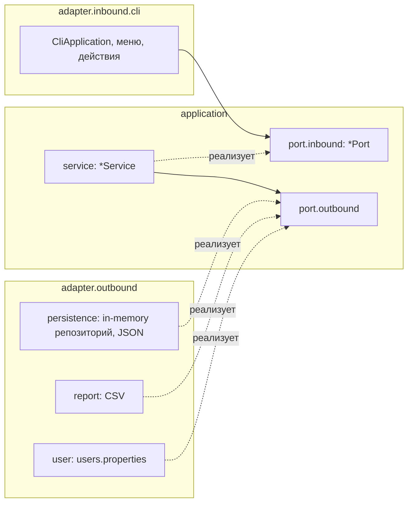

# Finance Manager

Консольное приложение для личных финансов на Java 25. Несколько пользователей входят по логину и
паролю, у каждого свой кошелёк: доходы и расходы по категориям, бюджеты, статистика, оповещения,
переводы между пользователями, экспорт и импорт данных. Управление через нумерованные меню.

Интерфейс приложения на английском языке, документация — на русском.

> **Пароли хранятся в открытом виде.** Файл `users.properties` содержит пары `логин=пароль` как
> есть, без хеширования, и пароль при входе сравнивается как строка. Это упрощение учебного проекта.
> Регистрации в приложении нет, пользователей добавляют правкой этого файла.

## Содержание

- [Возможности](#возможности)
- [Требования](#требования)
- [Запуск](#запуск)
- [Данные и настройки](#данные-и-настройки)
- [Как пользоваться](#как-пользоваться)
- [Пример сеанса](#пример-сеанса)
- [Архитектура](#архитектура)
- [Тесты](#тесты)
- [Качество кода и CI](#качество-кода-и-ci)
- [Ограничения](#ограничения)

## Возможности

| Область    | Что умеет                                                                                                                  |
|------------|----------------------------------------------------------------------------------------------------------------------------|
| Вход       | Несколько пользователей из `users.properties`, пароль без эха, если консоль это позволяет                                  |
| Операции   | Доходы и расходы с датой (по умолчанию сегодня, будущее запрещено) и комментарием, список за период                        |
| Категории  | Создание, переименование (с обновлением операций и бюджета), удаление, список по алфавиту; системная категория `Transfers` |
| Бюджеты    | Один лимит на расходную категорию без периода, остаток = лимит минус все расходы категории                                 |
| Статистика | Сводка за период, подсчёт по выбранным категориям (несколько имён через запятую)                                           |
| Оповещения | Превышение лимита бюджета и превышение расходов над доходами - в консоль                                                   |
| Переводы   | Перевод другому пользователю: расход у отправителя, доход у получателя, операция атомарна                                  |
| Отчёты     | Экспорт кошелька в JSON, операций в CSV, импорт JSON-снимка                                                                |
| Сохранение | Кошелёк пишется в файл при выходе из аккаунта и из приложения, при Ctrl+C и при конце ввода                                |
| Справка    | Пункт `Help` в меню: форматы ввода, пример диалога, правила, о которых важно знать                                         |

## Требования

- JDK 25

## Запуск

Сборка и запуск из готового дистрибутива (рекомендуется):

```bash
.\gradlew.bat installDist
build\install\finance-manager\bin\finance-manager.bat
```

Запуск через Gradle без отдельной сборки дистрибутива:

```bash
.\gradlew.bat run --console=plain -q
```

При первом запуске приложение создаёт каталог данных `data` рядом с рабочим каталогом и файл
`data/users.properties` с тремя демонстрационными пользователями:

| Логин   | Пароль         |
|---------|----------------|
| `alice` | `alice-demo-1` |
| `bob`   | `bob-demo-2`   |
| `carol` | `carol-demo-3` |

Выход из приложения: пункт `0` главного меню, Ctrl+Z или Ctrl+D (конец ввода) или Ctrl+C. Во всех
случаях изменённые кошельки сохраняются.

## Данные и настройки

Каталог данных по умолчанию `./data`. Изменить его можно системным свойством или переменной
окружения (свойство главнее):

Содержимое каталога данных:

| Путь                                              | Что это                                                                                              |
|---------------------------------------------------|------------------------------------------------------------------------------------------------------|
| `users.properties`                                | Пользователи, по строке `логин=пароль`. Логин: латинские буквы, цифры, `_`, `-`, от 3 до 32 символов |
| `wallets/<логин>.json`                            | Кошелёк пользователя: категории, бюджеты, операции. Запись атомарная (временный файл и перенос)      |
| `exports/<логин>-<yyyyMMdd-HHmmss>.json` и `.csv` | Экспорт данных                                                                                       |

Логи пишутся в `logs/finmanager.log` рабочего каталога, а не в терминал.

## Как пользоваться

Меню до входа: `1 Log in`, `2 Help`, `0 Exit`. После входа:

```
=== Finance Manager | alice | Balance: 54,700.00 ===
1. Operations
2. Categories and budgets
3. Statistics
4. Transfer
5. Reports
6. Help
7. Log out
0. Exit the application
```

| Пункт                    | Подпункты                                                                                                           |
|--------------------------|---------------------------------------------------------------------------------------------------------------------|
| 1 Operations             | 1 Add income, 2 Add expense, 3 List operations                                                                      |
| 2 Categories and budgets | 1 Create category, 2 List categories, 3 Rename category, 4 Delete category, 5 Set or change budget, 6 Delete budget |
| 3 Statistics             | 1 Summary, 2 Totals for selected categories                                                                         |
| 5 Reports                | 1 Export JSON snapshot, 2 Export operations to CSV, 3 Import JSON snapshot                                          |

Пункты 4 `Transfer` и 6 `Help` запускают диалог и справку сразу. В подменю `0` означает `Back`.

### Правила ввода

- Пункт меню выбирается числом и Enter; пробелы по краям ввода игнорируются.
- В любом вопросе диалога слово `cancel` (регистр не важен) отменяет диалог и возвращает в меню.
- Сумма: `1500`, `1500.50` или `1500,50`, не больше двух знаков после запятой, больше нуля,
  не больше `999,999,999.99`. Экспоненциальная запись (`1e3`) не поддерживается.
- Дата: `dd.mm.yyyy`, например `08.11.2026`. Enter вместо даты операции означает «сегодня».
  Даты периода в списках и статистике могут быть и в будущем.
- Комментарий необязателен, до 100 символов, без управляющих символов.
- Названия категорий: без запятой и управляющих символов; слово `cancel` и название `Transfers`
  зарезервированы.
- Вопросы «да или нет» принимают `yes` и `no`.
- Перед вопросом о категории приложение показывает доступные категории нужного типа.
- Неверный формат (не число, не дата) повторяет вопрос. Отказ по правилам (например, нет такой
  категории или недостаточно средств) завершает диалог сообщением, и снова показывается меню.

### Оповещения

Оповещения печатаются после операции, которая их вызвала, с пометкой `[!]`:

```
[!] Budget limit exceeded for category "Utilities": spent 3,000.00 against a limit of 2,500.00 (over by 500.00).
[!] Expenses (8,300.00) exceed income (5,000.00).
```

Остаток бюджета ровно 0.00 превышением не считается.

### Переводы

Перевод создаёт у отправителя расход в системной категории `Transfers` с контрагентом-получателем,
а у получателя доход в `Transfers` с контрагентом-отправителем. Получатель может не входить в
приложение в этой сессии: его кошелёк загружается при необходимости и сохраняется при выходе.
Перевод отклоняется, если сумма больше баланса, получатель неизвестен или это вы сами. Если файл
кошелька получателя повреждён, не меняется ни один из кошельков.

### Экспорт и импорт

- **Экспорт JSON** сохраняет весь кошелёк (владелец, категории, бюджеты, операции). Формат тот же,
  что у файла `wallets/<логин>.json`.
- **Экспорт CSV** сохраняет операции: UTF-8 с BOM, разделитель `;`, строки через CRLF, поэтому файл
  открывается в Excel без настройки.
- В обоих случаях Enter вместо пути создаёт файл в `exports/`; недостающие каталоги создаются; если
  файл уже есть, приложение спрашивает о перезаписи.
- **Импорт** сначала просит подтверждение, затем читает файл и проверяет его целиком: формат,
  ссылки операций на категории, бюджеты только для расходных категорий и так далее. Кошелёк текущего
  пользователя заменяется только если проверка прошла полностью; иначе показываются до 10 первых
  ошибок, а кошелёк не меняется. Владельцем импортированного кошелька становится вошедший
  пользователь; если в файле указан другой, выводится уведомление. Для теста импорта можно
  использовать файл по адресу `examples/bob-wallet.json`

## Пример сеанса

Сокращённый вывод настоящего запуска: вход alice, две категории, доход, расход, список операций и
сводка (повторяющиеся меню опущены).

```
=== Finance Manager ===
1. Log in
2. Help
0. Exit
Choose an option: 1
Login: alice
Password:

=== Categories and budgets ===
...
Choose an option: 1
Type (1 - income, 2 - expense): 2
Category name: Food
Category "Food" (expense) created.

=== Operations ===
...
Choose an option: 1
Available categories: Salary, Transfers.
Category: Salary
Amount (example: 1500.50): 60000
Date (dd.mm.yyyy, Enter - today):
Comment (Enter - skip): Monthly pay
Income added: Salary, 60,000.00 (08.11.2026).

Choose an option: 2
Available categories: Food, Transfers.
Category: Food
Amount (example: 1500.50): 800
Date (dd.mm.yyyy, Enter - today):
Comment (Enter - skip): Lunch
Expense added: Food, 800.00 (08.11.2026).

Choose an option: 3
Period start (dd.mm.yyyy, Enter - skip):
Period end (dd.mm.yyyy, Enter - skip):
+---+------------+---------+----------+-----------+--------------+-------------+
| # | Date       | Type    | Category |    Amount | Counterparty | Comment     |
+---+------------+---------+----------+-----------+--------------+-------------+
| 1 | 08.11.2026 | income  | Salary   | 60,000.00 |              | Monthly pay |
| 2 | 08.11.2026 | expense | Food     |    800.00 |              | Lunch       |
+---+------------+---------+----------+-----------+--------------+-------------+

=== Statistics ===
...
Choose an option: 1
Total income: 60,000.00
Total expenses: 800.00
Balance: 59,200.00

Income by category
+----------+-----------+
| Category |    Amount |
+----------+-----------+
| Salary   | 60,000.00 |
+----------+-----------+

Expenses by category
+----------+--------+
| Category | Amount |
+----------+--------+
| Food     | 800.00 |
+----------+--------+
```

Если задать бюджеты, сводка добавляет блок `Budgets by category` с лимитом, потраченной суммой и
остатком по каждой расходной категории.

## Архитектура

Приложение построено по схеме «порты и адаптеры» (чистая архитектура): бизнес-логика не знает ни о
консоли, ни о файлах, зависимости направлены внутрь.



Корневой пакет `org.example.finmanager`:

| Пакет                          | Назначение                                                                                                                                                       |
|--------------------------------|------------------------------------------------------------------------------------------------------------------------------------------------------------------|
| `config`                       | Spring-конфигурация (`AppConfig`: сканирование компонентов, `Clock`, `ObjectMapper`) и `AppProperties` (каталог данных)                                          |
| `application.dto`              | Неизменяемые модели (`WalletDto`, `OperationDto`, ...), команды и результаты сервисов                                                                            |
| `application.port.inbound`     | Что приложение умеет: `UserAccessPort`, `OperationPort`, `CategoryPort`, `BudgetPort`, `StatisticsPort`, `TransferPort`, `AlertPort`, `ReportPort`, `WalletPort` |
| `application.port.outbound`    | Что приложению нужно снаружи: хранилище кошельков и пользователей, файлы снимков, CSV                                                                            |
| `application.service`          | Бизнес-правила: по сервису на inbound-порт и вспомогательные `WalletRules`, `InputRules`, `WalletValidator`                                                      |
| `adapter.inbound.cli`          | Консольный интерфейс: меню, диалоги, разбор ввода, таблицы, каталог сообщений                                                                                    |
| `adapter.outbound.persistence` | Кошельки в памяти и в JSON-файлах, снимки, атомарная запись                                                                                                      |
| `adapter.outbound.report`      | Запись операций в CSV                                                                                                                                            |
| `adapter.outbound.user`        | Чтение `users.properties`                                                                                                                                        |

Стек: Java 25, Spring Framework (только контекст, без Spring Boot), Jackson, MapStruct, Lombok,
Logback, JUnit 6 и AssertJ, Gradle, Checkstyle, JaCoCo.

## Тесты

```bash
./gradlew.bat test       # только тесты
./gradlew.bat check      # тесты, Checkstyle и проверка покрытия
./gradlew.bat build      # то же плюс сборка дистрибутива (команда CI)
```

Отчёты после запуска:

| Что             | Где                                               |
|-----------------|---------------------------------------------------|
| Тесты           | `build/reports/tests/test/index.html`             |
| Покрытие JaCoCo | `build/reports/jacoco/test/html/index.html`       |
| Checkstyle      | `build/reports/checkstyle/main.html`, `test.html` |

Тесты разделены по уровням:

| Уровень                | Что проверяет                                                                                                                                      | Примеры                                                                                       |
|------------------------|----------------------------------------------------------------------------------------------------------------------------------------------------|-----------------------------------------------------------------------------------------------|
| Модульные, application | Бизнес-правила сервисов с ручными заглушками файловых портов                                                                                       | `OperationServiceTest`, `TransferServiceTest`, `ReportServiceTest`                            |
| Модульные, CLI         | Разбор ввода, форматирование, таблицы, меню, каталог сообщений                                                                                     | `AmountParserTest`, `TableRendererTest`, `MenuRunnerTest`                                     |
| Модульные, адаптеры    | Файлы во временном каталоге: JSON, CSV, `users.properties`, повреждённые файлы                                                                     | `JsonWalletFileStorageTest`, `CsvOperationsWriterTest`                                        |
| Сценарные              | Настоящий Spring-контекст, скриптовый ввод, фиксированные часы (сегодня 08.11.2026), временный каталог данных                                      | `BudgetScenarioTest`, `TransferScenarioTest`, `PersistenceScenarioTest`, `ReportScenarioTest` |
| Сквозные               | Приложение запускается отдельным процессом JVM с настоящими `System.in` и `System.out`; проверяются код выхода, файлы и сохранение между запусками | `EndToEndProcessTest`                                                                         |

Всего около 600 тестов, покрытие строк около 97%. Сборка падает, если покрыто меньше 80% строк.

## Качество кода и CI

- **Checkstyle** (стиль Google, длина строки 100, `maxWarnings = 0`): любое замечание ломает
  сборку. Конфигурация в `config/checkstyle`.
- **GitHub Actions** (`.github/workflows/build.yml`): на каждый push и pull request запускается
  `./gradlew build`. отчёты прикладываются как артефакты.

## Ограничения

- Пароли хранятся и сравниваются в открытом виде (см. предупреждение в начале).
- Интерфейс только на английском языке.
